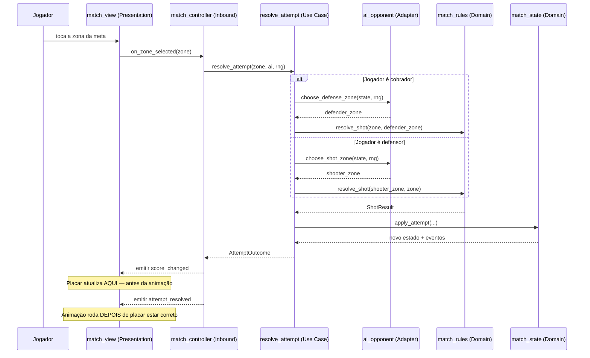

# Contrato: API dos Casos de Uso e Sinais

**Feature**: `001-penalty-match-mvp` | **Date**: 2026-10-17
**Camadas**: Application (`scripts/application/`) e Presentation (`scripts/presentation/`)
**Requisitos**: FR-025, FR-042, FR-046, FR-047, FR-049, FR-050, Artigo IV

Contrato da fronteira entre a **aplicação** e a **apresentação**. Define como a UI solicita ações e
como reage aos eventos do jogo, sem que a apresentação detenha regras.

---

## 1. Princípio de separação

| Camada | Responsabilidade | NÃO faz |
|---|---|---|
| **Application** | Orquestra casos de uso, decide o resultado | Não conhece nós, cenas ou animações |
| **Presentation** | Exibe, anima, coleta entrada | Não calcula placar, não decide resultado |

**Regra de ouro** (Artigo IV, FR-049): a apresentação **reflete** o estado; nunca o **define**.

---

## 2. Casos de uso

### `start_match`

```gdscript
## Inicia uma nova partida.
## Pré: perfil do jogador definido, personagem escolhido.
## Pós: partida em REGULAR, com sorteio realizado.
func start_match(profile: PlayerProfile) -> MatchState
```

### `draw_lots`

```gdscript
## Realiza o sorteio de cara ou coroa (FR-007).
## Usa rng_port — determinístico em teste.
func draw_lots(rng: RngPort) -> CoinToss
```

### `start_attempt`

```gdscript
## Prepara uma cobrança. Não resolve nada ainda.
## Retorna o contexto que a apresentação precisa para animar a preparação.
func start_attempt() -> AttemptContext
```

### `resolve_attempt`

```gdscript
## Resolve uma cobrança e atualiza o estado.
##
## É a operação central. A resolução ocorre ANTES de qualquer animação (FR-025).
##
## Parâmetros:
##   player_zone: zona escolhida pelo jogador
##   ai: implementação da IA (adapter)
##   rng: fonte de aleatoriedade (adapter)
##
## Retorna: AttemptOutcome com o resultado e o estado atualizado.
func resolve_attempt(
    player_zone: ShotZone,
    ai: AiOpponent,
    rng: RngPort
) -> AttemptOutcome
```

### `reset_match`

```gdscript
## Reinicia a partida, descartando todo o estado anterior (FR-050).
func reset_match() -> MatchState
```

---

## 3. Estruturas de dados

### `AttemptOutcome`

```gdscript
## Resultado completo de uma cobrança, pronto para a apresentação.
class AttemptOutcome:
    var shooter_index: int       ## quem cobrou
    var defender_index: int      ## quem defendeu
    var shooter_zone: ShotZone   ## zona do cobrador
    var defender_zone: ShotZone  ## zona do defensor
    var result: ShotResult       ## GOAL | DEFENDED | OUT_OF_BOUNDS
    var state: MatchState        ## estado APÓS a cobrança
    var events: Array[MatchEvent] ## eventos para a apresentação
```

### `PlayerProfile`

```gdscript
class PlayerProfile:
    var child_name: String
    var child_age: int
    var dog_name: String
    var dog_age: int
    var controlled_character: CharacterId  ## CHILD ou DOG
```

### `MatchEvent`

```gdscript
## Eventos emitidos para a apresentação reagir.
enum MatchEvent {
    ATTEMPT_RESOLVED,     ## uma cobrança terminou
    TURN_CHANGED,         ## trocou quem cobra
    ROUND_CHANGED,        ## nova rodada
    PHASE_CHANGED,        ## REGULAR -> SUDDEN_DEATH, etc.
    EARLY_FINISH,         ## encerramento antecipado (FR-017)
    MATCH_FINISHED,       ## partida terminou
}
```

---

## 4. Contrato do adapter de IA

```gdscript
## Nível de dificuldade da IA (FR-043).
## Crianças até 10 anos escolhem entre EASY e HARD; acima de 10 anos, NORMAL.
enum AiDifficulty {
    EASY,    ## mais fácil — para crianças menores
    NORMAL,  ## padrão — acima de 10 anos
    HARD,    ## mais difícil — opção para crianças até 10 anos
}

## Escolhe a zona de chute da IA.
## NÃO recebe a zona do defensor jogador (FR-042).
func choose_shot_zone(state: MatchState, rng: RngPort) -> ShotZone

## Escolhe a zona de defesa da IA.
## NÃO recebe a zona do cobrador jogador (FR-042).
func choose_defense_zone(state: MatchState, rng: RngPort) -> ShotZone

## Define a dificuldade aplicada à partida (FR-043).
## Pré: child_age informado no cadastro.
## Pós: retorna a dificuldade correspondente à faixa de idade.
func resolve_difficulty(child_age: int, chosen: AiDifficulty) -> AiDifficulty
```

### Regra de faixa de idade (FR-043)

| Idade da criança | Dificuldades disponíveis |
|---|---|
| **Até 10 anos** | `EASY` ou `HARD` — **duas opções**, selecionáveis |
| **Acima de 10 anos** | `NORMAL` — padrão, não selecionável |

**Requisito de teste (T-33)**: `resolve_difficulty(8, HARD) == HARD` e
`resolve_difficulty(12, HARD) == NORMAL` — a idade acima de 10 sobrepõe a escolha.

### Restrição crítica de interface (FR-042)

As funções da IA **não recebem** a zona secreta do adversário. Isso é uma garantia de **interface**,
não apenas de comportamento:

| Permitido receber | Proibido receber |
|---|---|
| `MatchState` (placar, rodada, cobranças, fase) | A zona escolhida pelo jogador |
| `RngPort` | Qualquer referência ao input do jogador |

**Teste de verificação (T-26)**: chamar `choose_defense_zone(state, rng)` com o mesmo `state` e
`rng` antes e depois de o jogador escolher sua zona deve produzir o **mesmo** resultado. Se
produzir resultados diferentes, a IA está trapaceando.

---

## 5. Sinais da apresentação

Declarados nos **nós de apresentação** — nunca no domínio (o domínio não depende do Godot,
Artigo IV).

```gdscript
## Emitido quando uma cobrança é resolvida. A apresentação anima o resultado.
signal attempt_resolved(outcome: AttemptOutcome)

## Emitido quando o turno muda.
signal turn_changed(shooter_index: int)

## Emitido quando a partida termina.
signal match_finished(winner_index: int, final_score: Array[int])

## Emitido quando o placar muda (para a UI do placar).
signal score_changed(score: Array[int])

## Emitido quando a introdução termina ou é pulada.
signal intro_finished()
```

### Ordem de emissão

```text
resolve_attempt()
    ├── 1. calcula resultado
    ├── 2. aplica ao estado            <- placar JÁ atualizado aqui
    ├── 3. emite score_changed         <- UI atualiza imediatamente
    ├── 4. emite attempt_resolved      <- animação começa
    └── 5. se terminou:
           emite match_finished        <- vai para a tela final
```

**Ponto crítico** (FR-025, Artigo VI.8): o passo 2 ocorre **antes** do passo 4. O placar está
correto no instante em que a animação começa. Se a animação for interrompida, pulada ou o FPS
cair, o placar permanece correto.

---

## 6. Fluxo completo de uma cobrança



---

## 7. Contratos da apresentação

### Seleção de zona

```gdscript
## Traduz a posição de toque/clique em uma das 9 zonas.
## Retorna -1 se o toque ocorreu fora da meta.
func zone_at_position(local_pos: Vector2) -> int

## Destaque visual da zona sob o cursor/toque.
func highlight_zone(zone: int) -> void
```

**Requisito de acessibilidade (Artigo VIII.3, VIII.4)**: mouse, teclado e toque devem produzir o
**mesmo** resultado. O adapter escolhe a implementação conforme a plataforma, mas a zona resultante
é idêntica.

### Placar

```gdscript
## Atualiza o placar a partir do estado. Nunca calcula o placar.
func update_score(score: Array[int]) -> void

## Indica quem está cobrando e quem está defendendo (FR-046).
func update_turn(shooter_index: int, defender_index: int) -> void

## Exibe o resultado da última cobrança (FR-047).
func show_attempt_result(result: ShotResult) -> void
```

**Restrição (FR-049)**: `update_score` **recebe** o placar; nunca o deriva. O placar vive apenas em
`MatchState`.

---

## 8. Requisitos de teste

| # | Teste | Requisito |
|---|---|---|
| T-26 | IA não acessa a zona do jogador (mesma entrada → mesma saída) | FR-042 |
| T-27 | Placar atualizado antes de `attempt_resolved` | FR-025 |
| T-28 | `zone_at_position` cobre as 9 zonas corretamente | FR-032 |
| T-29 | Mouse, teclado e toque produzem a mesma zona | Artigo VIII.4 |
| T-30 | `reset_match` limpa todos os sinais e estado | FR-050 |
| T-31 | Apresentação não altera o placar em nenhuma circunstância | FR-049 |
| T-32 | Interromper a animação não altera o placar | FR-025 |

---

## 9. O que este contrato NÃO define

| Fora do escopo | Onde |
|---|---|
| Regra de resolução das zonas | [`zone-grid.md`](./zone-grid.md) |
| Placar, turnos, morte súbita | [`match-rules.md`](./match-rules.md) |
| Layout visual das telas | Implementação em `scenes/` |
| Escolha concreta da IA | `scripts/adapters/outbound/ai_opponent.gd` |
| Implementação do RNG | `scripts/adapters/outbound/godot_rng.gd` |
