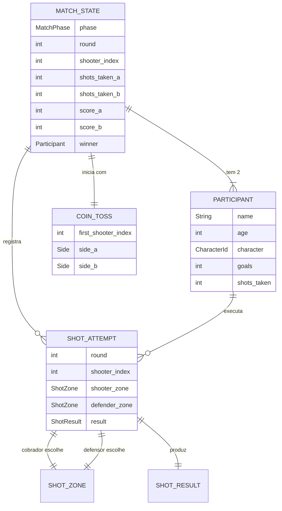
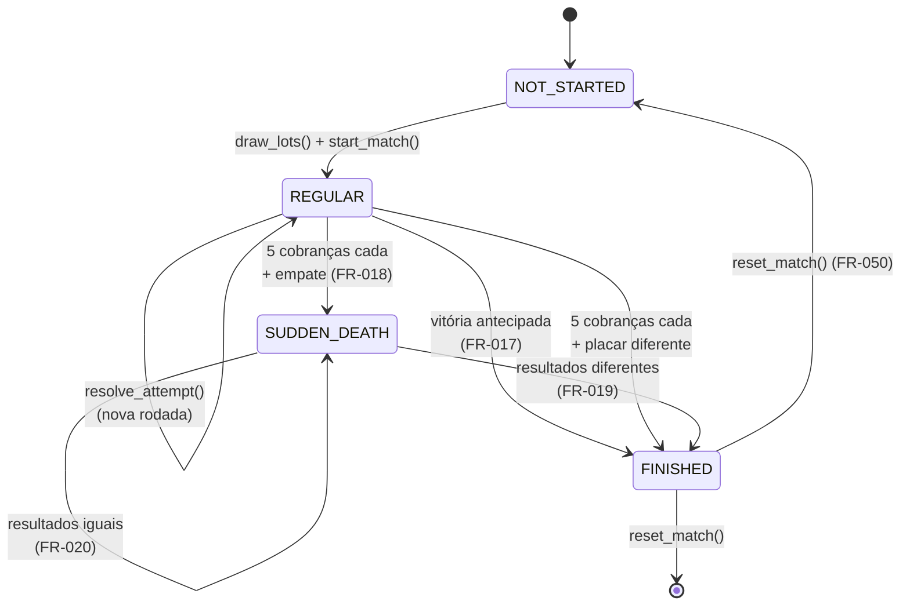

# Data Model: Aventuras na Grama! — Primeira Versão Jogável

**Feature**: `001-penalty-match-mvp` | **Date**: 2026-10-17

Modelo conceitual do domínio. Descreve entidades, atributos, invariantes e transições de estado,
derivados dos requisitos da [spec](./spec.md). Nomes de código em inglês (Artigo I.2);
descrições em pt-BR (Artigo I.1).

**Nota**: este modelo descreve o **domínio**, que não depende de nós ou cenas do Godot
(Artigo IV). Nenhuma entidade abaixo referencia `Node`, `Node2D` ou `Control`.

---

## Diagrama de entidades



---

## Entidades

### `MatchState`

Representa uma partida completa. É a **única fonte de verdade** do placar (Artigo VI.9, FR-049).

| Campo | Tipo | Descrição | Regra |
|---|---|---|---|
| `phase` | `MatchPhase` | Fase atual da partida | Ver máquina de estados |
| `round` | `int` | Rodada atual (1-based) | Incrementa quando ambos cobraram |
| `shooter_index` | `int` | Índice do participante que cobra agora | 0 ou 1 |
| `score_a` / `score_b` | `int` | Gols de cada participante | ≥ 0; imutável após encerramento (FR-024) |
| `shots_taken_a` / `shots_taken_b` | `int` | Cobranças já realizadas | ≥ 0; nunca diminui (FR-022) |
| `winner` | `Participant` \| `null` | Vencedor | `null` enquanto `phase != FINISHED` |
| `participants` | `Array[Participant]` | Os dois participantes | Exatamente 2 |

**Invariantes**:
1. `participants.size() == 2` sempre.
2. `score_* >= 0` e `shots_taken_* >= 0`.
3. Se `phase == FINISHED`, então `winner != null`.
4. Se `phase != FINISHED`, então `winner == null`.
5. `score_*` e `shots_taken_*` não mudam após `FINISHED` (FR-024).
6. `shots_taken_*` é monotonicamente crescente (FR-022).

---

### `Participant`

Um dos dois lados da partida. Os nomes **não** são fixos no domínio (FR-003 / Artigo VI.3).

| Campo | Tipo | Descrição | Regra |
|---|---|---|---|
| `name` | `String` | Nome informado no cadastro | Não vazio (FR-045) |
| `age` | `int` | Idade informada | Ver Assumptions — idade não bloqueia o jogo |
| `character` | `CharacterId` | `CHILD` ou `DOG` | Um de dois valores |
| `goals` | `int` | Gols marcados | ≥ 0; espelha `score_*` |
| `shots_taken` | `int` | Cobranças realizadas | ≥ 0 |

**Nota de nomenclatura**: "Pedro" e "Branquinha" são **valores de exibição**, não constantes do
domínio (Artigo VI.3). O domínio conhece apenas `CharacterId.CHILD` e `CharacterId.DOG`.

---

### `ShotAttempt`

Uma cobrança individual. Registra **as duas escolhas** e o resultado derivado.

| Campo | Tipo | Descrição | Regra |
|---|---|---|---|
| `round` | `int` | Rodada em que ocorreu | ≥ 1 |
| `shooter_index` | `int` | Quem cobrou | 0 ou 1 |
| `shooter_zone` | `ShotZone` | Zona escolhida pelo cobrador | Uma das 9 |
| `defender_zone` | `ShotZone` | Zona escolhida pelo defensor | Uma das 9 |
| `result` | `ShotResult` | Resultado | Derivado — ver regra abaixo |

**Regra de derivação** (FR-060) — determinística, sem aleatoriedade (FR-061):

```text
resolve(shooter_zone, defender_zone):
    if shooter_zone == defender_zone:            -> DEFENDED
    else if shooter_zone in {TOP_LEFT, TOP_RIGHT}: -> OUT_OF_BOUNDS
    else:                                         -> GOAL
```

**Verificação**: as 81 combinações (9 × 9) são enumeráveis e testáveis (SC-005a).

---

### `ShotZone`

Uma das 9 áreas da meta (FR-032, FR-062). Unidade de decisão do cobrador e do defensor.

**Estrutura**: 3 colunas × 3 alturas.

| Coluna → / Altura ↓ | Esquerda | Centro | Direita |
|---|---|---|---|
| **Cima** | `TOP_LEFT` | `TOP_CENTER` | `TOP_RIGHT` |
| **Meio** | `MIDDLE_LEFT` | `MIDDLE_CENTER` | `MIDDLE_RIGHT` |
| **Baixo** | `BOTTOM_LEFT` | `BOTTOM_CENTER` | `BOTTOM_RIGHT` |

**Propriedades**:
- `is_top_corner(zone)`: verdadeiro apenas para `TOP_LEFT` e `TOP_RIGHT` — as únicas zonas que
  produzem bola para fora (FR-060).
- **Nenhuma zona é inútil** (FR-062): todas as 9 são válidas para chute e para defesa. O meio
  nunca resulta em bola para fora por si só.

**Importante**: "bola para fora" **não** é uma zona. É um **resultado**. Não existe uma décima
opção selecionável (FR-016, Clarifications).

---

### `ShotResult`

Resultado de uma cobrança (FR-016). Três valores possíveis:

| Valor | Significado | Efeito no placar |
|---|---|---|
| `GOAL` | O cobrador marcou | `+1` para o cobrador |
| `DEFENDED` | O defensor defendeu | Nenhum |
| `OUT_OF_BOUNDS` | A bola saiu | Nenhum |

**Nota**: `OUT_OF_BOUNDS` é **consequência** de escolher um canto alto contra uma zona diferente —
nunca uma escolha do jogador (FR-016).

---

### `MatchPhase`

Fases da partida (FR-026). Transições válidas abaixo.

| Valor | Descrição |
|---|---|
| `NOT_STARTED` | Antes do sorteio |
| `REGULAR` | Cinco cobranças iniciais por participante (FR-014) |
| `SUDDEN_DEATH` | Morte súbita após empate (FR-018) |
| `FINISHED` | Partida encerrada com vencedor |

---

### `CoinToss`

Resultado do sorteio inicial (FR-007).

| Campo | Tipo | Descrição |
|---|---|---|
| `first_shooter_index` | `int` | Quem cobra primeiro |
| `side_a` / `side_b` | `Side` | Lado inicial de cada participante |

---

### `AiDifficulty`

Nível de dificuldade da inteligência artificial (FR-043).

| Valor | Quando se aplica |
|---|---|
| `EASY` | Criança **até 10 anos** — opção mais fácil, selecionável |
| `NORMAL` | Criança **acima de 10 anos** — padrão, não selecionável |
| `HARD` | Criança **até 10 anos** — opção mais difícil, selecionável |

**Regra de faixa de idade**:

| Idade da criança | Dificuldades disponíveis |
|---|---|
| Até 10 anos | `EASY` ou `HARD` (duas opções) |
| Acima de 10 anos | `NORMAL` (padrão) |

**Nota**: a dificuldade **não** altera as regras da partida — apenas a distribuição de escolhas
da IA. O resultado continua sendo resolvido por `resolve_shot` (FR-061). A dificuldade é um
**parâmetro do adapter** `ai_opponent`, não do domínio.

---

## Máquina de estados da partida



### Regras de transição

| De | Para | Condição | Requisito |
|---|---|---|---|
| `NOT_STARTED` | `REGULAR` | Sorteio realizado e partida iniciada | FR-007, FR-013 |
| `REGULAR` | `REGULAR` | Cobrança resolvida, rodada incompleta | FR-015 |
| `REGULAR` | `REGULAR` | Cobrança resolvida, nova rodada iniciada | FR-015 |
| `REGULAR` | `FINISHED` | Adversário não pode mais alcançar o placar | FR-017 |
| `REGULAR` | `FINISHED` | Ambos cobraram 5 vezes e o placar difere | FR-014 |
| `REGULAR` | `SUDDEN_DEATH` | Ambos cobraram 5 vezes e o placar é igual | FR-018 |
| `SUDDEN_DEATH` | `SUDDEN_DEATH` | Ambos cobraram e os resultados da rodada são iguais | FR-020 |
| `SUDDEN_DEATH` | `FINISHED` | Ambos cobraram e os resultados da rodada diferem | FR-019 |
| `FINISHED` | `NOT_STARTED` | Reinício da partida | FR-050 |

### Transições inválidas (devem ser recusadas)

| Tentativa | Motivo | Requisito |
|---|---|---|
| Resolver cobrança em `FINISHED` | Partida encerrada | FR-024 |
| Mesmo participante cobrar duas vezes na rodada | Cobrança duplicada | FR-022 |
| Cobrar fora da vez | Turno inválido | FR-023 |
| Declarar vencedor em `SUDDEN_DEATH` antes do 2º cobrar | Encerramento prematuro | FR-021 |
| Alterar placar em `FINISHED` | Imutabilidade | FR-024 |

---

## Regras de negócio derivadas

### Encerramento antecipado (FR-017)

Ocorre em `REGULAR` quando o participante em desvantagem **não pode mais alcançar** o adversário
com as cobranças iniciais restantes.

```text
remaining_for_trailing = 5 - shots_taken[trailing]
max_possible_trailing  = score[trailing] + remaining_for_trailing
if max_possible_trailing < score[leading]:
    -> FINISHED, winner = leading
```

**Atenção ao limite exato**: o encerramento só ocorre quando o alcance é **estritamente
impossível**. Se `max_possible == score[leading]`, a partida **continua** — empate ainda é
alcançável. Este é o edge case "vitória antecipada no limite exato" da spec.

### Morte súbita (FR-019, FR-020, FR-021)

Em `SUDDEN_DEATH`, cada rodada tem uma cobrança de cada participante:

1. Ambos cobram (o segundo **não** pode ser dispensado — FR-021).
2. Se os resultados diferem em "marcou/não marcou", o que marcou vence (FR-019).
3. Se ambos marcaram ou ambos não marcaram, continua (FR-020).
4. Sem limite artificial de rodadas.

**Erro comum a evitar**: declarar vencedor assim que o primeiro participante da rodada marca. Isso
viola FR-021.

### Alternância de papéis (FR-015)

A cada tentativa, o papel de cobrador e defensor **alterna entre os participantes**. Quem é
cobrador em uma rodada é defensor na seguinte. A apresentação reflete isso (FR-046), mas o domínio
é quem decide.

---

## Validações

| # | Validação | Onde | Requisito |
|---|---|---|---|
| V-01 | Nome não vazio | Cadastro | FR-045 |
| V-02 | Idade preenchida | Cadastro | FR-003 |
| V-03 | Participante da vez | Domínio | FR-023 |
| V-04 | Sem cobrança duplicada na rodada | Domínio | FR-022 |
| V-05 | Partida não encerrada | Domínio | FR-024 |
| V-06 | Zona dentro das 9 válidas | Domínio | FR-032 |
| V-07 | Exatamente 2 participantes | Domínio | FR-001 |
| V-08 | Nenhum vencedor antes do 2º cobrar na morte súbita | Domínio | FR-021 |

**Nota sobre V-01/V-02**: a validação de cadastro ocorre na **apresentação** (formulário), mas a
regra é do domínio. A apresentação apenas indica o campo pendente (FR-056).

---

## O que este modelo deliberadamente NÃO inclui

| Ausente | Motivo |
|---|---|
| Persistência / save | Fora do escopo da v1 (Assumptions, R-06) |
| Entidade de "goleiro" | Não existe: o defensor é o outro protagonista (FR-015) |
| Zona "para fora" | Não existe: "bola para fora" é resultado, não zona (FR-016) |
| Estatísticas acumuladas | Melhoria futura (Escopo) |
