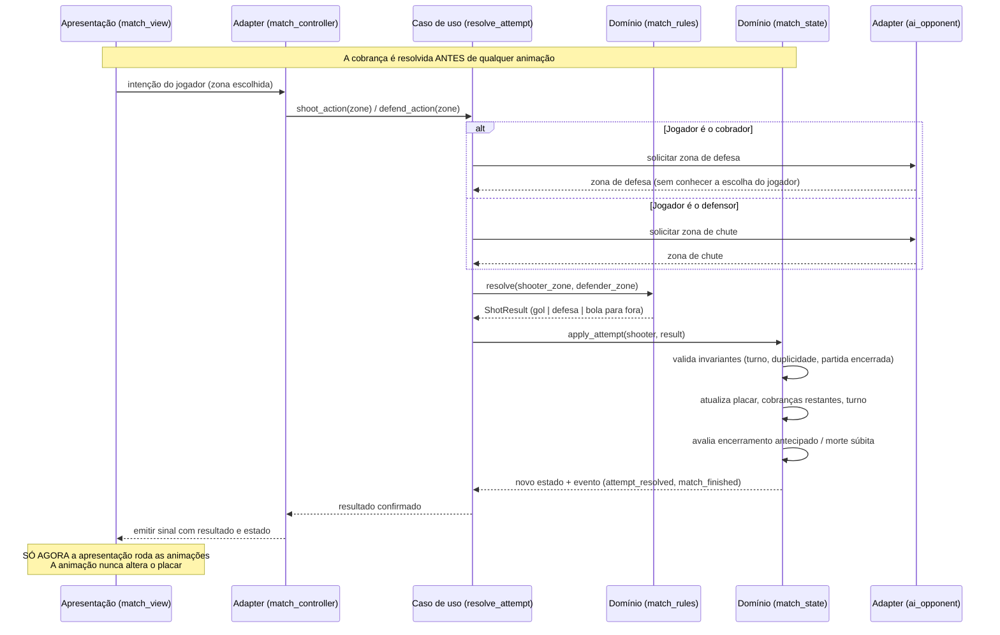

# Implementation Plan: Aventuras na Grama! — Primeira Versão Jogável

**Branch**: `001-penalty-match-mvp` | **Date**: 2026-10-17 | **Spec**: [spec.md](./spec.md)

**Input**: Feature specification from `/specs/001-penalty-match-mvp/spec.md`

## Summary

Implementar a primeira versão jogável do jogo infantil de pênaltis **Aventuras na Grama!** em
Godot 4 com GDScript tipado, dentro do projeto Godot existente em `dog-friend-gol/`.

O núcleo é a **disputa de pênaltis**: cada participante tem 5 cobranças iniciais alternadas,
com encerramento antecipado quando o alcance se torna matematicamente impossível e morte súbita
em caso de empate. Cada cobrança é resolvida por uma **regra determinística sobre uma grade de 9
zonas** (3 colunas × 3 alturas): mesma zona defendida resulta em defesa; zonas diferentes
resultam em gol, exceto os cantos altos, que resultam em bola para fora. Não há aleatoriedade e
o placar independe de animações.

A abordagem técnica separa as **regras da partida** (GDScript puro, sem dependência de nós) da
**apresentação** (cenas e nós do Godot), permitindo testar a lógica sem renderização. A
integração entre as camadas usa sinais do Godot. O mesmo código atende Web e Android.

O projeto está **vazio de código** — contém apenas `project.godot`, ícone e referências visuais.
Toda a implementação parte do zero, mas reutiliza o projeto Godot existente sem recriá-lo.

## Technical Context

**Language/Version**: GDScript — **Godot 4.7.2.stable.official.ed1daf0bf** (verificado em execução). Tipagem explícita obrigatória (Constituição, Artigo II.2)

**Primary Dependencies**: Nenhuma dependência externa. Apenas recursos nativos do Godot (Constituição, Artigo II.7). Ferramenta de teste: GUT (addon GDScript), conforme R-01.

**Storage**: N/A — sem banco de dados, sem persistência entre sessões na v1 (Constituição, Artigo IX.1). O cadastro vive apenas em memória durante a partida.

**Testing**: **GUT (Godot Unit Test)**, conforme decisão R-01 em [`research.md`](./research.md). Addon GDScript nativo (compatível com Artigo II.7). **Execução headless comprovada**: `godot --headless --script res://_probe.gd` imprimiu `GODOT_HEADLESS_OK`. O addon GUT ainda não está instalado.

**Target Platform**: Web (HTML5/WebAssembly) e Android (APK de depuração), a partir da mesma base de código (Constituição, Artigo II.4, II.5, II.6).

**Project Type**: Aplicação de jogo (Godot, 2D) — projeto único dentro de `dog-friend-gol/`.

**Performance Goals**: 60 FPS em desktop; alvo de estabilidade em dispositivos Android de entrada e navegadores compatíveis. Sem metas de latência de rede (tudo local).

**Constraints**:
- Sem backend, APIs externas ou banco de dados (Artigo IX.1)
- Lógica executável sem renderização (Artigo VII.1, VI.10)
- Exportação Web sem dependência de `file://` (requer servidor HTTP)
- **Godot 4.7.2 disponível** no Windows; executável headless a partir do WSL via UNC
- **Templates de exportação ausentes** — bloqueiam CA-06 e CA-09
- **Toolchain Android ausente**: sem Android SDK, sem `adb`, JDK é 25 (Godot exige 17)
- **Nenhum `export_presets.cfg` existe** — precisa ser criado

**Scale/Scope**: Escopo pequeno e fechado. Uma partida, dois participantes, 9 zonas, 3 resultados. Sem multijogador, sem rede, sem persistência. 5 user stories, 63 requisitos funcionais, 14 critérios de sucesso.

## Constitution Check

*GATE: Must pass before Phase 0 research. Re-check after Phase 1 design.*

| Artigo | Requisito | Status | Evidência / Nota |
|---|---|---|---|
| **I.1** | Documentação em pt-BR | ✅ PASS | Spec, plano e artefatos em pt-BR |
| **I.2** | Código (classes, funções, variáveis, sinais) em inglês | ✅ PASS | Nomenclatura de código planejada em inglês (`PenaltyMatch`, `ShotZone`, `resolve_shot`) |
| **II.1** | Motor Godot 4.x | ✅ PASS | `project.godot` declara 4.7 |
| **II.2** | GDScript com tipagem explícita | ✅ PASS | Planejado como requisito de implementação |
| **II.3** | Recursos nativos do Godot | ✅ PASS | Sinais, cenas, nós, `Control`/`Node2D`, `AnimationPlayer` |
| **II.4** | Mesma base para Web e Android | ✅ PASS | Projeto único; adaptações isoladas na apresentação |
| **II.5** | APK Android instalável | ⚠️ **RISCO** | Toolchain ausente neste ambiente; plano inclui provisionamento |
| **II.6** | Exportação Web com recursos suportados | ⚠️ **RISCO** | Renderer `gl_compatibility` já configurado (adequado à Web); requer servidor HTTP |
| **II.7** | Sem Go/TypeScript/C#/extensões nativas | ✅ PASS | Apenas GDScript |
| **II.8** | Dependências justificadas | ✅ PASS | Nenhuma dependência externa; ferramenta de teste será justificada |
| **III.3** | Código dentro de `dog-friend-gol/` | ✅ PASS | Toda a implementação confinada ao projeto Godot |
| **III.5** | Não criar outro projeto Godot nem duplicar `project.godot` | ✅ PASS | Reutiliza o projeto existente |
| **IV** | Arquitetura hexagonal pragmática | ✅ PASS | domain / application / adapters / bootstrap / presentation |
| **IV.1–IV.6** | Direção das dependências | ✅ PASS | Domínio sem dependência de nós; apresentação sem regras |
| **V** | Estrutura lógica de diretórios | ✅ PASS | Ver "Project Structure"; sem diretórios vazios |
| **VI** | Regras do domínio | ✅ PASS | Estado explícito, transições válidas, determinismo |
| **VII.1** | Domínio testável isoladamente | ✅ PASS | Regras em GDScript puro |
| **VII.4** | Ferramenta de testes compatível, escolhida no planejamento | ⚠️ **PENDENTE** | Fase 0 — ver `research.md` |
| **VII.5–VII.8** | Executar testes antes de declarar conclusão; não afirmar sem evidência | ✅ PASS | Plano exige evidência; limitações registradas |
| **VIII** | UX infantil, acessibilidade, adaptação de tela | ✅ PASS | Controles por zona; `canvas_items` + `expand` já configurados |
| **IX.1** | Lógica local, sem backend | ✅ PASS | |
| **IX.5** | Exportações validadas antes de publicar | ⚠️ **RISCO** | Depende de ambiente com Godot + toolchain |
| **X** | Fluxo Spec Kit + Superpowers | ✅ PASS | constitution → specify → clarify → plan |
| **XII** | Segurança: segredos fora do Git, `.gitignore` inspecionado | ⚠️ **AÇÃO** | Ver "Security Findings" — lacunas reais identificadas |

**Resultado do gate**: **PASS com riscos registrados**. Nenhuma violação constitucional que exija
justificativa na tabela de Complexity Tracking. Os itens ⚠️ são riscos de ambiente e pendências de
decisão, não violações de princípio.

## Project Structure

### Documentation (this feature)

```text
specs/001-penalty-match-mvp/
├── plan.md              # Este arquivo
├── research.md          # Fase 0 — decisões e alternativas
├── data-model.md        # Fase 1 — entidades, invariantes, transições
├── quickstart.md        # Fase 1 — guia de validação executável
├── contracts/           # Fase 1 — contratos internos entre camadas
│   ├── match-rules.md
│   ├── zone-grid.md
│   └── use-case-api.md
├── checklists/
│   └── requirements.md  # Checklist de qualidade da spec
└── tasks.md             # Fase 2 — NÃO criado por /speckit-plan
```

### Source Code (repository root)

A estrutura abaixo respeita o Artigo V da Constituição e as convenções do Godot. Diretórios são
criados **conforme necessário** — nenhum diretório vazio é criado antecipadamente (Artigo V).

```text
dog-friend-gol/                          # raiz do projeto Godot (Artigos III.3, III.7)
├── project.godot                        # existente — NÃO recriar (Artigo III.5)
├── icon.svg                             # existente
├── export_presets.cfg                   # A CRIAR — presets Android e Web
├── assets/                              # existente — recursos do jogo (renomeado de `assests`)
│   ├── references/                      # existente — referências visuais, não alterar
│   └── private/                         # existente — conteúdo privado, IGNORADO pelo Git
├── scripts/
│   ├── domain/                          # regras puras, sem nós (Artigo IV — Domain)
│   │   ├── shot_zone.gd                 # enum/grid de 9 zonas + conversões
│   │   ├── shot_result.gd               # enum: gol, defesa, bola para fora
│   │   ├── match_rules.gd               # resolução determinística da cobrança
│   │   ├── match_state.gd               # estado + invariantes + transições
│   │   ├── match_phase.gd               # fases: cobranças iniciais, morte súbita, encerrada
│   │   ├── participant.gd               # participante (nome, idade, personagem, gols)
│   │   └── shot_attempt.gd              # cobrança individual (zonas, resultado, rodada)
│   ├── application/
│   │   ├── use_cases/
│   │   │   ├── start_match.gd           # iniciar partida
│   │   │   ├── start_attempt.gd         # iniciar uma cobrança
│   │   │   ├── resolve_attempt.gd       # resolver cobrança e atualizar placar
│   │   │   ├── draw_lots.gd             # sorteio de cara ou coroa
│   │   │   └── reset_match.gd           # reiniciar partida
│   │   ├── actions/                     # intenções explícitas (Artigo IV)
│   │   │   ├── shoot_action.gd
│   │   │   ├── defend_action.gd
│   │   │   └── choose_character_action.gd
│   │   └── ports/
│   │       ├── match_repository.gd      # contrato de persistência (NÃO usado na v1 — ver research)
│   │       └── rng_port.gd              # contrato de aleatoriedade (sorteio e IA)
│   ├── adapters/
│   │   ├── inbound/
│   │   │   ├── match_controller.gd      # traduz entrada do jogador → casos de uso
│   │   │   ├── input_zone_selector.gd   # mouse/teclado → zona
│   │   │   └── touch_zone_selector.gd   # toque → zona
│   │   └── outbound/
│   │       ├── godot_rng.gd             # implementação de rng_port
│   │       └── ai_opponent.gd           # IA local (implementa decisões de zona)
│   ├── bootstrap/
│   │   └── game_bootstrap.gd            # composição de dependências
│   └── presentation/                    # sinais e integração de cena (Artigo IV — Presentation)
│       ├── match_view.gd                # reage a eventos do jogo, atualiza UI
│       ├── scoreboard_view.gd           # placar e cobranças realizadas
│       ├── character_animator.gd        # animações de chute/defesa/comemoração
│       └── screen_router.gd             # navegação entre telas
├── scenes/
│   ├── main_menu.tscn                   # tela inicial
│   ├── registration.tscn                # cadastro (nome/idade)
│   ├── character_select.tscn            # escolha do protagonista
│   ├── intro.tscn                       # introdução (pulável)
│   ├── match.tscn                       # tela da partida
│   ├── ending.tscn                      # comemoração + abraço + oferta
│   └── components/
│       ├── zone_grid.tscn               # grade de 9 zonas clicável
│       └── scoreboard.tscn              # placar reutilizável
├── assets/                              # A CRIAR — recursos finais (não as referências)
│   ├── sprites/
│   ├── animations/
│   └── audio/
└── tests/
    ├── unit/
    │   ├── test_zone_resolution.gd      # 81 combinações + regra de resolução (T-01 a T-07)
    │   ├── test_shot_zone.gd            # conversões de zona (T-08, T-09)
    │   ├── test_match_state.gd          # invariantes e transições (T-10 a T-25)
    │   ├── test_player_profile.gd       # validação de cadastro (US2)
    │   └── test_ai_difficulty.gd        # regra de idade × dificuldade (T-33, US2)
    └── integration/
        ├── test_ai_fairness.gd          # IA não acessa a zona do jogador (T-26, US3)
        ├── test_ai_variation.gd         # variação entre partidas (SC-010, US3)
        ├── test_ai_context.gd           # reação ao estado (FR-040, US3)
        ├── test_intro_skip.gd           # pular introdução preserva estado (FR-058, US4)
        ├── test_ending_flow.gd          # abraço nos dois casos + oferta opcional (US4)
        ├── test_new_match.gd            # reinício sem resíduo (T-24, T-30, US5)
        └── test_match_flow.gd           # determinismo ponta a ponta (SC-005)
```

**Structure Decision**: projeto Godot único (não há frontend/backend separados). A separação
interna segue a arquitetura hexagonal pragmática do Artigo IV, com cinco camadas nomeadas em
`scripts/`. As cenas ficam em `scenes/` e os recursos em `assets/`, que já contém
`assets/references/` (material de referência visual) e `assets/private/` (conteúdo privado,
ignorado pelo Git conforme o Artigo XII).

**Nota sobre `assets/`**: o diretório estava grafado `assests` (erro de digitação). Foi
**renomeado para `assets/`** em 2026-10-17, após verificação de que nenhum código, cena,
configuração ou arquivo `.import` referenciava o nome antigo. Detalhes em
[`research.md`](./research.md) → R-05.

## Fluxo Técnico de uma Cobrança

Descrição de como uma cobrança começa, é processada e termina, e como a interface reage.



**Pontos-chave do fluxo**:

1. **A resolução precede a animação.** O resultado é calculado e aplicado ao estado antes de a
   apresentação tocar qualquer animação (FR-025, Artigo VI.8). A animação apenas *apresenta* um
   resultado já decidido.
2. **A IA decide sem conhecer a escolha do jogador.** O adapter `ai_opponent` recebe o contexto da
   partida, mas não a zona secreta do jogador (FR-042).
3. **O estado é a única fonte de verdade.** O placar vive em `match_state`; a interface apenas
   reflete (FR-049, Artigo VI.9).
4. **Validação no domínio.** Cobrança duplicada, turno inválido e alteração após encerramento são
   recusados na camada de domínio, não na UI (FR-022, FR-023, FR-024).

## Arquitetura e Responsabilidades

| Camada | Diretório | Responsabilidade | Depende de |
|---|---|---|---|
| **Domain** | `scripts/domain/` | Regras da partida, estado, invariantes, transições, resolução de cobrança | Nada (GDScript puro) |
| **Application** | `scripts/application/` | Casos de uso, ações, contratos (ports) | Domain |
| **Adapters** | `scripts/adapters/` | Entrada do jogador, IA, RNG | Application + Domain |
| **Bootstrap** | `scripts/bootstrap/` | Composição e injeção de dependências | Todas |
| **Presentation** | `scripts/presentation/` + `scenes/` | Cenas, nós, animações, UI | Application (via sinais) |

**Direção das dependências** (Artigo IV): as setas apontam para dentro. O domínio não conhece
nenhuma camada externa — nem `Node`, nem `Node2D`, nem sinais do Godot.

**Comunicação entre camadas**: os casos de uso expõem resultados e emitem **sinais do Godot**; a
apresentação se conecta a esses sinais. Isso mantém a apresentação reativa sem que ela detenha
regras (Artigo IV — Presentation).

**Sobre `ports/`**: o Artigo IV permite ports "quando aplicável" e exige evitar abstração
desnecessária. Há **um** caso com benefício real: `rng_port` — o sorteio de cara ou coroa e a IA
precisam de aleatoriedade, e isolar isso permite **testes determinísticos** (injetar um RNG com
semente fixa). `match_repository` é registrado apenas como ponto de extensão para persistência
futura e **não é implementado na v1**; se permanecer sem uso concreto, deve ser removido
(Artigo V — não criar classes artificiais).

## Requisitos Funcionais Pendentes

| Origem | Pendência | Situação |
|---|---|---|
| **Resolvido** | Aparência canônica dos protagonistas | ✅ **Uniforme verde "M"** (FR-052) |
| **Resolvido** | Efeito da idade sobre a dificuldade da IA | ✅ **Até 10 anos: duas dificuldades**; acima: padrão (FR-043) |
| **Resolvido** | FR-062 vs. cantos altos | ✅ **Manter a regra** — risco por design; FR-062 reescrito |
| **Resolvido** | Grafia de `assests/` | ✅ **Renomeado** para `assets/` (R-05) |
| **Resolvido** | Godot instalado? | ✅ **Sim** — 4.7.2, Windows; headless funciona a partir do WSL |
| **Ambiente** | Templates de exportação ausentes | 🔴 Bloqueia CA-06 e CA-09. Instalar via editor |
| **Ambiente** | Android SDK + `adb` ausentes | 🔴 Bloqueia CA-07 e CA-08 |
| **Ambiente** | JDK 25 (Godot exige 17) | 🟡 Necessário para exportação Android |
| **Ambiente** | Addon GUT não instalado | 🟡 Bloqueia CA-02, CA-03 e CA-05 |
| Plano | **`internal/`** — criar ou não | Artigo V: não é obrigatória. Sem necessidade demonstrada, **não criar**. |
| Plano | **Nomenclatura de exibição do jogo** — "Aventuras na Grama!" é provisória | Confirmar antes da UI final. |

## Conflitos com Especificações Existentes

**Nenhum conflito não resolvido.** Durante o planejamento foram identificados e resolvidos três
pontos de divergência, todos registrados na spec:

| Divergência | Resolução | Documento |
|---|---|---|
| Spec dizia 6 zonas; o pedido do plano dizia 9 combinações | **9 zonas** (3 colunas × 3 alturas) — spec emendada em FR-032, FR-060, FR-062, SC-005a, entidade "Zona" e Clarifications | `spec.md` |
| "Não haverá opção de chute para fora" vs. FR-016/FR-060 | "Bola para fora" permanece como **resultado**, não como escolha. FR-016 reforçado explicitamente | `spec.md` |
| Pedido menciona "goleiro" | Não há goleiro separado: o defensor é o outro protagonista (FR-015). Registrado em Clarifications | `spec.md` |

**Documentos que precisam de atualização** (fora do escopo desta etapa):

| Documento | Motivo | Ação |
|---|---|---|
| `.specify/memory/constitution.md` | A Constituição está em v1.1.0 e já cobre todos os princípios aplicáveis. | Nenhuma alteração necessária |
| `.gitignore` (raiz e `dog-friend-gol/`) | Lacunas de segurança e de artefatos de exportação identificadas | Ver "Security Findings" |
| `specs/001-penalty-match-mvp/spec.md` | Emendada nesta etapa (9 zonas) | Feito |
| `AGENTS.md` / `.github/copilot-instructions.md` | Podem ganhar referência aos comandos de exportação | Após definir os comandos |

## Security Findings

Verificações realmente executadas (Constituição, Artigo XII). Nenhum valor sensível foi impresso.

| Verificação | Comando | Resultado |
|---|---|---|
| Segredos em arquivos rastreados | padrões AKIA / PRIVATE KEY / ghp_ / sk- | ✅ nenhum (118 arquivos) |
| Arquivos sensíveis rastreados | `.env`, `*.pem`, `*.key`, keystore, `.npmrc`, `id_rsa` | ✅ nenhum |
| Segredos no histórico do Git | todas as revisões | ✅ nenhum (2 commits) |
| `credential.helper` | `git config` | ✅ nenhum |

**Lacunas reais identificadas** (não corrigidas — fora do escopo deste comando):

| Lacuna | Risco | Ação proposta |
|---|---|---|
| ~~`dog-friend-gol/assests/private/` não ignorado~~ | ~~Conteúdo privado pode ser versionado~~ | ✅ **CORRIGIDO** — `dog-friend-gol/assets/private/` adicionado ao `.gitignore` |
| ~~Keystores Android não ignorados~~ | ~~Chave de assinatura pode vazar~~ | ✅ **CORRIGIDO** — `*.keystore`, `*.jks`, `*.p12`, `*.pfx`, `*.pepk` adicionados |
| ~~Artefatos de exportação não ignorados~~ | ~~Binários grandes no repositório~~ | ✅ **CORRIGIDO** — `*.apk`, `*.aab`, `*.pck`, `*.wasm`, `build/`, `export/` adicionados |
| `export_presets.cfg` **não** é ignorado (deliberado) | Ele é necessário para reproduzir a exportação (CA-11), mas **o Godot grava a senha do keystore em texto claro** | ✅ **Documentado** — versionar com os campos de senha **vazios**; senhas reais vêm de variável de ambiente ou entrada manual. Regra registrada no próprio `.gitignore`. |
| `dog-friend-gol/.gitignore` cobre `.godot/` e `/android/` | ✅ suficiente para o cache do Godot | — |

## Riscos de Exportação

### Android

| Risco | Severidade | Mitigação |
|---|---|---|
| **Toolchain ausente neste ambiente** — sem `ANDROID_HOME`, sem `adb`, sem JDK configurado | 🔴 **Alta** | Documentar provisionamento (JDK 17, Android SDK, build-tools, platform-tools, `debug.keystore`); validação exige ambiente com o toolchain |
| Templates de exportação Android não instalados | 🔴 **Alta** | Baixar via Godot Editor ou `godot --install-android-build-template` |
| `export_presets.cfg` inexistente | 🟡 Média | Criar preset com identificador de aplicativo, ícone, orientação e permissões mínimas |
| **`export_presets.cfg` pode conter senha do keystore** | 🟡 Média | Versionar exemplo sem senha; senha via variável de ambiente ou fora do Git (Artigo XII) |
| Física 3D (`Jolt`) configurada em projeto 2D | 🟢 Baixa | Inofensivo, mas convém avaliar remoção da configuração 3D não usada |
| Controles por toque não implementados | 🟡 Média | Adapter `touch_zone_selector` na camada de apresentação |
| Validação em dispositivo real | 🔴 **Alta** | Sem dispositivo disponível, o critério **não pode ser declarado aprovado** — registrar como não verificado |

### Web

| Risco | Severidade | Mitigação |
|---|---|---|
| Exportação Web exige servidor HTTP (não funciona em `file://`) | 🟡 Média | Documentar `python3 -m http.server` ou equivalente |
| `gl_compatibility` já configurado | 🟢 Baixa | ✅ Renderer adequado à Web |
| Threads/SharedArrayBuffer requerem cabeçalhos COOP/COEP | 🟡 Média | Evitar dependência de threads; documentar cabeçalhos se necessário |
| Tamanho do build e tempo de carregamento | 🟡 Média | Recursos enxutos (Artigo IX.3) |
| Áudio em navegador exige interação do usuário | 🟡 Média | Iniciar áudio após o primeiro toque/clique |
| `project.godot` define `rendering_device/driver.windows="d3d12"` | 🟢 Baixa | Específico de Windows; não afeta Web/Android |

## Complexity Tracking

Nenhuma violação constitucional que exija justificativa. A tabela permanece vazia por decisão
consciente: a arquitetura hexagonal do Artigo IV é aplicada **pragmaticamente**, com apenas um
port com benefício real (`rng_port`) e sem repositório implementado na v1.

| Violation | Why Needed | Simpler Alternative Rejected Because |
|-----------|------------|-------------------------------------|
| — | — | — |

## Critérios de Aceitação

Derivados do pedido e da spec. O projeto **não** é considerado concluído apenas porque compila ou
porque os arquivos de exportação foram gerados.

| # | Critério | Como validar | Estado (2026-10-17) |
|---|---|---|---|
| CA-01 | Projeto Godot abre e executa | `godot --headless --path <UNC> --import` | ✅ **APROVADO** — import sem erros |
| CA-02 | As 9 combinações de zona funcionam | Teste das 81 combinações (SC-005a) | ✅ **APROVADO** — `test_zone_resolution.gd` 7/7 |
| CA-03 | Regras documentadas implementadas | Testes de unidade do domínio | ✅ **APROVADO** — `test_match_state.gd` 16/16 |
| CA-04 | Interface e animações integradas | Execução manual no editor | ⚠️ **NÃO VERIFICADO** — requer editor visual |
| CA-05 | Testes automatizados passam | Executar a suíte | ✅ **APROVADO** — 54/54 passed |
| CA-06 | APK de depuração gerado | Preset + `godot --export-debug` | 🔴 **BLOQUEADO** — templates + SDK + JDK 17 ausentes |
| CA-07 | APK instala e inicia | `adb install` + abrir | 🔴 **BLOQUEADO** — sem `adb` nem dispositivo |
| CA-08 | Partida completa jogável no Android | Execução manual em dispositivo | 🔴 **BLOQUEADO** — sem dispositivo |
| CA-09 | Versão Web exportada | Preset + `godot --export-release` | 🔴 **BLOQUEADO** — templates ausentes |
| CA-10 | Versão Web jogável em navegador | Servir por HTTP e jogar | 🔴 **BLOQUEADO** — depende de CA-09 |
| CA-11 | Procedimentos de exportação reproduzíveis | Seguir `quickstart.md` | ⚠️ **PARCIAL** — documentado, não executado |
| CA-12 | Documentação técnica atualizada | Revisão dos artefatos | ✅ **APROVADO** — README + plan atualizados |

**Resultado da implementação (2026-10-17)**: suíte completa **54/54 passed** (14 scripts, 81298
asserts). O domínio, os casos de uso, os adapters e a apresentação foram implementados e validados
por testes automatizados headless.

**Aprovados**: CA-01, CA-02, CA-03, CA-05, CA-12.

**Não verificados (requerem editor visual ou dispositivo)**: CA-04, CA-11.

**Bloqueados (requerem templates de exportação, Android SDK, JDK 17 ou dispositivo físico)**:
CA-06, CA-07, CA-08, CA-09, CA-10.

**Critérios não executados são registrados como não verificados, nunca como aprovados**
(Artigo VII.7). Os critérios SC-006 (partida < 5 min), SC-007 (identificar cobrador sem instrução)
e SC-011 (paridade navegador/Android) dependem de observação com uma criança e de dispositivo real
— **não podem** ser declarados aprovados neste ambiente.

## Dependencies

| Dependência | Tipo | Situação |
|---|---|---|
| Godot 4.7.2 | Ferramenta | ✅ **Instalado** (`/mnt/c/Users/franc/Downloads/Godot_v4.7.2-stable_win64.exe/`) |
| Execução headless a partir do WSL | Capacidade | ✅ **Comprovada** |
| Templates de exportação | Ferramenta | ❌ **Ausentes** — bloqueiam CA-06 e CA-09 |
| Android SDK + build-tools + platform-tools | Ferramenta | ❌ Ausente |
| `adb` | Ferramenta | ❌ Ausente |
| JDK 17 | Ferramenta | ⚠️ Ambiente tem JDK **25**; Godot exige **17** |
| Addon GUT | Dependência de dev | ❌ Não instalado — bloqueia CA-02, CA-03, CA-05 |
| Servidor HTTP local | Ferramenta | ⚠️ `python3` não resolvido no PATH |
| Referências visuais | Recurso | ✅ Existentes em `assets/references/` (5 arquivos) |
| Recursos visuais finais | Recurso | ❌ A produzir (14 itens pendentes na spec) |

## Phase 0: Research — Resumo

Detalhamento completo em [`research.md`](./research.md). Decisões consolidadas:

| # | Decisão | Alternativas consideradas |
|---|---|---|
| R-01 | Ferramenta de teste: **GUT** (pendente de validação de disponibilidade) | GoDotTest; testes manuais; sem framework |
| R-02 | Representação da zona: **enum + conversão para coluna/altura** | `Vector2i`; string; recursos |
| R-03 | Comunicação entre camadas: **sinais do Godot** | Chamadas diretas; barramento de eventos; autoload singleton |
| R-04 | Aleatoriedade: **port `rng_port` com semente injetável** | `randi()` direto (não testável) |
| R-05 | Grafia `assests/`: **renomeado para `assets/`** ✅ executado | Preservar e conviver com os dois (revertida) |
| R-06 | Persistência: **nenhuma na v1** | Arquivo de save; `ConfigFile` |
| R-07 | `match_repository`: **não implementar** na v1 | Implementar para uso futuro (contraria Artigo V) |
| R-08 | Controles: **seleção de zona por região clicável/toque** | Setas de teclado; arrasto direcional |
| R-09 | IA: **escolha ponderada por contexto + variação** | IA determinística; IA que lê a escolha do jogador (proibido por FR-042) |
| R-10 | Exportação: **`export_presets.cfg` com presets Web e Android; artefatos fora do Git** | Versionar presets com segredos (proibido pelo Artigo XII) |

## Phase 1: Design — Artefatos Gerados

| Artefato | Conteúdo |
|---|---|
| [`data-model.md`](./data-model.md) | Entidades, atributos, invariantes, máquina de estados da partida, regras de validação |
| [`contracts/zone-grid.md`](./contracts/zone-grid.md) | Contrato da grade de 9 zonas e da função de resolução |
| [`contracts/match-rules.md`](./contracts/match-rules.md) | Contrato das regras: placar, turnos, encerramento antecipado, morte súbita |
| [`contracts/use-case-api.md`](./contracts/use-case-api.md) | Contrato dos casos de uso e sinais expostos à apresentação |
| [`quickstart.md`](./quickstart.md) | Guia de validação executável, incluindo exportação Web e Android |

**Re-avaliação do Constitution Check após a Fase 1**: sem novas violações. Os contratos mantêm o
domínio livre de dependências de nós e preservam a direção das dependências do Artigo IV.
